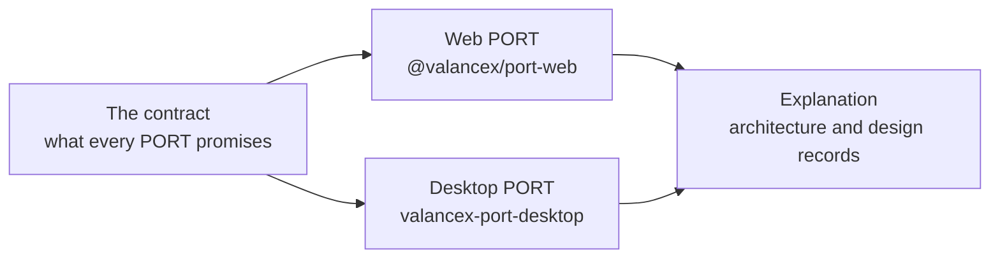

# PORT documentation

> **TL;DR:** A PORT draws a render tree on a target (the browser's DOM, or a desktop window) and reports what the person does. Start with the contract every PORT keeps; read a target's README when you build on it.

## Prerequisites

* What a render tree is: MESH's [Rendering MESH output](https://github.com/ValanceX/Mesh/blob/main/docs/how-to/rendering-mesh-output.md) explains it.

---

## Where to go

## Reference

| Page | What it answers |
|---|---|
| [The PORT contract](reference/contract.md) | `draw`, `update`, `unmount` (and the optional `patch`) in, `(handler, payload)` out, and the rules for values and events |
| [API stability](reference/stability.md) | What each public surface of the three packages promises |
| [Release notes](reference/releases/) | Each version in full; the [changelog](../CHANGELOG.md) is the summary |

## The two targets

- **The Web PORT** (`@valancex/port-web`): its [README](../packages/port-web/README.md), then [how it realizes each value in each slot](explanation/design-records/2026-09-28-web-value-realization.md).
- **The Desktop PORT** (`valancex-port-desktop`): its [README](../packages/port-desktop/README.md) (the vocabulary, the contract, `vlx-window`), with its vocabulary as data in [`@valancex/port-desktop-vocabulary`](../packages/port-desktop-vocabulary/README.md).

## Explanation

- [**Architecture**](explanation/architecture.md): PORT's responsibilities and rules, the packages, and why the first PORT is an experiment.
- [**Roadmap**](explanation/roadmap.md): the phases from the boundary freeze to V1, what is done and what is not.

<b>The design record</b>

* [Integration audit](explanation/design-records/2026-09-27-port-integration-audit.md): the evidence behind the boundary.
* [MESH semantic handoff](explanation/design-records/2026-09-27-mesh-semantic-handoff.md), with the [event propagation audit](explanation/design-records/2026-09-27-event-propagation-audit.md) and the [value realization audit](explanation/design-records/2026-09-27-value-realization-audit.md).
* The Desktop PORT [architecture note](explanation/design-records/2026-10-14-port-desktop.md): why it is its own package, the host protocol, keys.
* Specs: [SSR and hydration](explanation/specs/2026-09-28-port-web-ssr.md), [patch application](explanation/specs/2026-10-06-port-web-patch-application.md), [API review baseline](explanation/specs/2026-10-09-api-review-freeze.md).

## Next steps

* [The PORT contract](reference/contract.md).
* Working on PORT itself? See [Contributing](../CONTRIBUTING.md).
